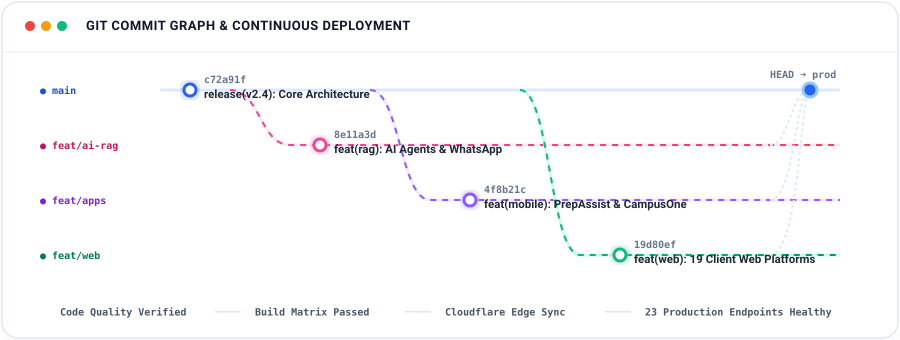

   

  <!-- Official XR Marketing Logo -->
  

    

  <!-- Brand Subtitle Tagline with Color Pips -->
  

    <b>FULL-STACK DIGITAL SYSTEMS</b> &nbsp;•&nbsp; 
    <b>MOBILE ENGINEERING</b> &nbsp;•&nbsp; 
    <b>AI AUTOMATIONS</b>
  

  <!-- Animated Interactive Subtitle -->
  

   

  <!-- Navigation Bar -->
  

    
    
    
    
    
    
  

---

## 🛠️ Technology Stack & Architecture

We architect full-stack applications with decoupled frontends, event-driven backends, and multi-cloud serverless infrastructure.

 

### 🎨 Frontend Engineering

  
  
  
  
  

### 📱 Mobile App Engineering

  
  
  
  

### ⚙️ Backend & API Services

  
  
  

### 🗄️ Database & Cloud Persistence

  
  

### ☁️ Cloud, Edge CDN & Media Delivery

  
  
  
  
  

### 🤖 Intelligent AI & Workflow Automations

  
  
  

---

## 🌐 Web Development Portfolio

19 production platforms engineered and deployed across diverse industries. Explore live projects or visit the [Official Web Portfolio ↗](https://xrmarketing.in/portfolio/).

 

### 🛍️ E-Commerce, D2C & Retail Brands

| Status | Project | Focus Area | Technology Highlights | Live Portal |
| :---: | :--- | :--- | :--- | :---: |
| 🟢 | **Holistikart** | Organic & Ayurvedic Goods | Storefront, Payment Gateway, SEO | [Launch ↗](https://holistikart.in) |
| 🟢 | **Liorastore** | High-Fashion & Apparel | Fast Catalog Filtering, Instant Cart | [Launch ↗](https://liorastore.in) |
| 🟢 | **Munch Tokri** | Gourmet Confectionery | Dynamic Hampers, Checkout Engine | [Launch ↗](https://munchtokri.com) |
| 🟢 | **Bottlebites** | Handcrafted Beverages & Dining | Interactive Menus, Order Dispatch | [Launch ↗](https://bottlebites.in) |
| 🟢 | **Bambrew** | Eco-Friendly Packaging | Sustainable Catalog, RFQ System | [Launch ↗](https://bambrew.in) |
| 🟢 | **Millet Maagic Meal** | Superfood Nutrition | Subscription Flow, Nutritional Calc | [Launch ↗](https://www.milletmaagicmeal.in) |
| 🟢 | **Aro Kitchen** | Cloud Kitchen Ordering | Live Order Sync, Real-Time Menu | [Launch ↗](https://arokitchen.in) |

 

### 🏢 Enterprise, Real Estate & Global Consulting

| Status | Project | Focus Area | Technology Highlights | Live Portal |
| :---: | :--- | :--- | :--- | :---: |
| 🟢 | **EO Visas** | Overseas Immigration Consulting | Country Eligibility Engine, Booking | [Launch ↗](https://eovisas.com) |
| 🟢 | **Suryakiran Real Estate** | Premium Real Estate Listings | Geo-tagged Properties, Inquiry Forms | [Launch ↗](https://suryakiranrealestate.in) |
| 🟢 | **The Little Oak Company** | Sustainable Global Brand | Multi-Region Brand Portfolio | [Launch ↗](https://thelittleoakcompany.global) |
| 🟢 | **Pavan Stones Group** | Natural Stone & Granite Export | Industrial Stone Specs, Export RFQs | [Launch ↗](https://pavanstonesgroup.online) |
| 🟢 | **Arbanox** | Luxury Architectural Hardware | Product Spec Sheets, Minimalist UI | [Launch ↗](https://arbanox.com) |
| 🟢 | **Classic Celebration Co.** | Luxury Bespoke Event Planning | Experiential Showcase, Inquiries | [Launch ↗](https://classiccelebrationco.com) |

 

### 🔧 Tech Services, Diagnostics & Infrastructure

| Status | Project | Focus Area | Technology Highlights | Live Portal |
| :---: | :--- | :--- | :--- | :---: |
| 🟢 | **AppleCare** | Apple Device Repair Portal | Instant Cost Estimator, Appointments | [Launch ↗](https://applecare.in) |
| 🟢 | **OnePlus Service Center** | Mobile Hardware Diagnostics | IMEI Lookup, Service Booking Hub | [Launch ↗](https://oneplusservice.center) |
| 🟢 | **TecArmour** | Cyber Defense & Hardware Security | Enterprise Shielding, IT Security | [Launch ↗](https://tecarmour.com) |

 

### 🌿 Healthcare, Clinical Care & Community

| Status | Project | Focus Area | Technology Highlights | Live Portal |
| :---: | :--- | :--- | :--- | :---: |
| 🟢 | **Holistic Minds** | Mental Health & Therapy Booking | Secure Teletherapy Booking Portal | [Launch ↗](https://holisticmind.in) |
| 🟢 | **Bhagnadantah** | Advanced Dentistry Practice | Clinical Patient Care, Treatments | [Launch ↗](https://bhagnadantah.com/) |
| 🟢 | **Citylifes** | Hyperlocal Urban Directory | Local Business Discovery, Events | [Launch ↗](https://citylifes.in) |

---

## 📱 Mobile Applications Portfolio

Enterprise and consumer mobile applications actively serving thousands of users on Android & iOS.

 

### 1. PrepAssist — AI-Powered UPSC Preparation
> Intelligent exam-readiness engine equipped with AI tutoring, Retrieval-Augmented Generation (RAG) over vast curricula, mock test analytics, and personalized revision schedules.

  
  

---

### 2. Hostel Project App
> Comprehensive accommodation booking, digital check-ins, mess management, room allocations, and student complaint resolution system.

  

---

### 3. CampusOne Parent App
> Real-time educational telemetry for parents: instantaneous attendance alerts, digital mark sheets, school announcements, homework tracking, and seamless fee settlements.

  

---

### 4. CampusOne Edusoft Teacher App
> Purpose-built enterprise classroom companion: fast student roll calls, automated report card creation, parent messaging, syllabus scheduling, and exam grading.

  

---

## ⚡ Git Activity & Contribution Stream

  <!-- GitHub Contribution Grid Snake Animation -->
  

    

  <!-- Visual Git Branching & Pipeline SVG -->
  

---

## 📬 Get in Touch

Commission a custom web platform, native mobile app, or AI automated system:

  
  
  
  
  

 

  © 2025 <a href="https://xrmarketing.in/"><b>XR Marketing</b></a>. High-performance digital products engineered for global scale.

